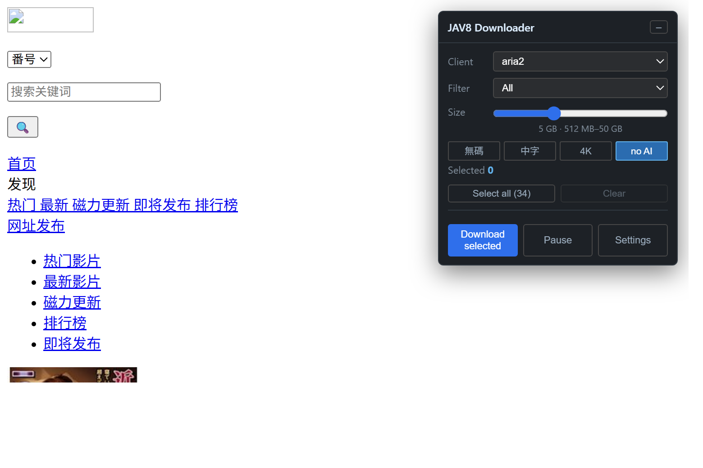

# JAV8 Downloader

> **This repo is 100% generated by AI using Opencode with the repo owner's supervision.**

A Chrome/Firefox userscript for [jav8.vip](https://jav8.vip). Tick the covers you
want, and it sends them to aria2 or qBittorrent. It picks the best magnet for
each release by size, so you get the full-quality version instead of a 200 MB
sample.



*Three works sent, nine left, batch paused. The site behind is blurred on purpose
— the panel is the whole point.*

<p align="center">
  <a href="https://github.com/mino29/jav8-dl/releases/latest">
    
  </a>
</p>

## Install

Three steps. The third is the one people miss.

1. **Install a userscript manager** — Tampermonkey or Violentmonkey. This one is
   not optional: aria2 and qBittorrent send no CORS headers, so only a manager's
   privileged request can reach them.
2. **Install the script** — open
   [`jav8-downloader.user.js`](https://raw.githubusercontent.com/mino29/jav8-dl/main/jav8-downloader.user.js)
   and accept the offer. It updates itself from then on.
3. **Tell it where your download client is** — press **Settings** in the panel and
   fill in the address. aria2 needs one option turned on before it will answer
   at all: see [below](#you-need-a-download-client-already-set-up).

Then reload any jav8.vip page and tick something.

That is all that is required. If you keep your collection on Jellyfin or Emby,
there is an optional extra: see [Play from your
library](#play-from-your-library-and-do-not-download-it-twice).

## You need a download client already set up

**This script does not install, start or configure aria2 or qBittorrent. It only
talks to one you already have.** Set the client up yourself first — by hand, or
with one of the install guides its own project links to. Nothing here will start
a client that is not running.

### aria2 needs one extra step

Out of the box **aria2 does not answer requests at all.** Its `--enable-rpc`
option ships set to `false`, so until you turn it on there is nothing listening
on port 6800 for this script — or anything else — to talk to. Add these to
`aria2.conf`, or pass them on the command line, then restart aria2:

```ini
enable-rpc=true
rpc-listen-all=false
rpc-secret=choose-a-token
```

- 🔒 `rpc-listen-all=false` binds loopback only, which is right when the browser
  is on the same machine. Set it to `true` to reach aria2 from a phone or a
  second machine — and in qBittorrent that is *Expose to local network* in
  Preferences → Web UI.
- 🔑 `rpc-secret` is optional, but without one anything that can reach the port
  can queue downloads on your machine. Paste the same token into the script's
  **RPC secret** field.
- 📝 Comments in `aria2.conf` start with `#`; the lines above have none.

### Then tell the script where it is

Open **Settings** in the panel. Each field shows the vendor default as a
placeholder, and an empty field *means* "keep the default" — so you only fill in
what you have changed.

| Field | aria2 | qBittorrent |
| --- | --- | --- |
| **Host** | `http://localhost` | `http://localhost` |
| **Port** | `6800` | `8080` |
| **RPC secret** | your `rpc-secret` token | — |
| **Username** / **Password** | — | Tools → Preferences → Web UI |
| **Save dir** / **Save path** | optional; blank uses the client's own | optional |
| **Category** | — | optional; blank uses the client's own |

From a phone or a second machine, use your machine's LAN address as the Host
instead of `localhost`.

Press **Test connection** before downloading anything — it checks without saving.
**Defaults** clears every override. The script also checks for itself at the start
of every batch: if the client is not answering it says so once, names the likely
reason, and sends nothing, so a client that is down costs one request rather than
one per work.

Settings are saved in your browser only. There is no config file and nothing is
sent anywhere. The script ships with `@connect *`, so the host can be anything
your browser can reach.

| Client | Official source | Setup guide |
| --- | --- | --- |
| aria2 | [github.com/aria2/aria2](https://github.com/aria2/aria2) | [aria2.github.io manual](https://aria2.github.io/manual/en/html/index.html) |
| qBittorrent | [github.com/qbittorrent/qBittorrent](https://github.com/qbittorrent/qBittorrent) | [wiki.qbittorrent.org](https://wiki.qbittorrent.org/) |

## Use it

On any listing page a small tick box appears on every cover. Tick what you want
and press **Download selected**. VR releases get a `VR` badge.

**Each work unticks itself once it has been dealt with**, whether it downloaded
or failed, so the batch empties the selection as it runs and the `Selected 17`
counter counts down as your progress bar. There is nothing to clear afterwards.
A failure is still named in the log, and re-ticking it is one click if you want
to retry. Works you stop with **Cancel all** stay ticked, since they were never
attempted.

In short:

- ✅ **Tick** the covers you want, press **Download selected**, and walk away
- 📏 **Size** slider picks the release closest to the size you asked for
- ▶️ **Already in your library?** It gets a play button instead of a second
  download — see [Jellyfin / Emby](#play-from-your-library-and-do-not-download-it-twice)
- 🙈 **Adverts are hidden** automatically — you never see or send one
- 🔁 **Queues keep going** when you change page, refresh, or open another tab
- ⏸️ **Pause** freezes everything without losing your place
- 🛑 **Cancel all** stops the lot, for when you change your mind
- 🧹 **Clear** empties the selection everywhere, in one click

The panel in the top right corner holds the controls:

| Control | What it does |
| --- | --- |
| **Client** | aria2 or qBittorrent |
| **Filter** | All, VR only, or non-VR only |
| **Size** | Preferred size, on a slider |
| **Select all / Clear** | Tick everything showing, or untick everything |
| **All works** | On a performer's page: send her entire filmography |
| **＋** | On any performer link: queue her entire filmography |
| **Pause / Start** | Hold everything, or let it go again |
| **Cancel all** | Stop every crawl and download in progress |
| **Settings** | Client address, credentials, save path, and the optional [Jellyfin / Emby](#play-from-your-library-and-do-not-download-it-twice) server |

### Several tabs at once

Open as many jav8.vip tabs as you like. They share **one selection and one pause
switch**:

- ✅ Tick a cover in any tab and it is ticked in all of them, immediately.
- 🧹 **Clear** in any tab clears all of them.
- ⏸️ **Pause** in any tab holds every tab's crawling and sending. Nothing is
  requested from the site while paused — not even the check that the download
  client is up.
- ➕ Work you tick *while a batch is already running* joins that batch. You do not
  have to press **Download selected** a second time.

A batch still belongs to the tab that started it: closing that tab stops it, and
other tabs keep their own selections.

### Pausing

**Pause** stops between items, so the next page fetch waits until you press
**Start** — mid-crawl as well as mid-download. It is a switch, not a stop: nothing
is lost, and pressing Start carries on from exactly where it was. **Cancel all**
is the one that throws work away.

### Preferred size

One slider, from 1 GB to 50 GB, defaulting to 5 GB. It picks releases between a
tenth and ten times that size, and among those it takes the one **closest to your
setting**. So with 5 GB selected and releases of 1.2 GB, 5.4 GB and 9 GB
available, you get the 5.4 GB one.

"Closest" is measured proportionally rather than in raw bytes: a 1 GB and a 9 GB
release are equally far from a 5 GB preference, because what matters is which
release is about the size you asked for.

The floor still does its original job of skipping 200 MB samples, and the
ceiling still excludes absurd multi-hundred-GB labels. If nothing fits the
window at all, the script still sends the largest real release and says so,
rather than quietly doing nothing.

### Release tags

The same release appears on a work page several times over, differing in what the
filename declares. Four of those declarations are worth choosing between, and
each is a toggle in the panel:

- 🔓 **無碼** — prefer the uncensored release.
- 🈶 **中字** — prefer the release with Chinese subtitles.
- 🖼️ **4K** — prefer the 4K release.
- 🤖 **no AI** — skip AI-generated releases. **On by default**; the other three
  are off.

They are *preferences*, not filters. A work that offers a matching release uses
it; a work that does not is still sent, and the panel says which preference it
set aside. Nothing is ever skipped for lacking a tag, because only about one
release in seven carries one at all — a rule that dropped the other six would
throw away most of your queue to honour a label.

The toggles are worth having because they choose **between magnets of the same
work**: of the works offering more than one release, three quarters offer a
genuine uncensored choice and two thirds a subtitled one.

Two notes on how this was worked out, because they are both easy to get wrong:

- 📐 The tags were **measured, not assumed** — counted across 783 releases from
  80 work pages. The obvious guesses were wrong: there is no `-CN` on this site
  at all, and no `無修正` either.
- 🀄 The same fact is written two different ways and the two barely overlap:
  uncensored is `-U` *or* `无码`, subtitles are `-C` *or* `-中文字幕`. Matching
  either spelling alone finds about half of what it claims to.

### Play from your library, and do not download it twice

If you keep your collection on **Jellyfin** or **Emby**, the script can read that
server and use it. Off by default, and nothing happens until you turn it on.

Set it up in **Settings → Jellyfin / Emby**: tick **Enabled**, give it the
address, and paste an **API key** from the server's own dashboard (*Dashboard →
API Keys → +*). Then press **Read library now**, or just reload a page. The panel
says how many titles it recognised and when it last looked.

**Name the library that holds your JAV**, from the **Library** dropdown — it is
read from your server when the panel opens, so it fills in a moment after the
dialog appears. It is optional, but it is the difference between one small
request and four large ones: measured on a real server holding films and
television too, the JAV library was 582 items out of 15,288. *All libraries* reads
everything, which works but makes the script look at a great many titles that
could never match. A library that has gone missing from the list — because the
server is unreachable right now — is kept and marked *(not listed)* rather than
cleared.

Once it is on:

- ▶️ **A play button appears on the cover** of every work you already have — a
  round button in the middle of the cover, about a ninth of its surface, in the
  style of Jellyfin's own. It opens that work's page in your media server, where
  playing is one click. Middle-click and *open in new tab* work the way they do on
  any link.
- ✅ **Select all steps over them**, and says how many it skipped. The same goes
  for **All works** and **＋** on a performer — her whole filmography is only worth
  having if it is the whole filmography you *lack*.
- ⬆️ **Ticking one by hand upgrades it instead.** You asked for that work on
  purpose, so the only reason is a better copy: the script takes the smallest
  release at least a quarter larger than the one you have, and says so. If nothing
  on the page is bigger, **nothing is sent** and the log tells you why. It will
  not hand you the same torrent again.

The panel reports the read as two numbers, and both are worth reading:

```
Library read: 583 items, 583 with a catalogue number.
```

The first is everything in the library you asked it to read. The second is how
many of those carry a catalogue number the site could match on — a file called
`Some Film (2019).mkv` has none, and can never be recognised. When those two
numbers differ the script says by how much and why, because "why is a work I own
still being offered?" is almost always this and not a bug.

Worth knowing:

- 🔍 **The match is the catalogue number, not the title.** A cover carries
  `fex-004`; a file called `FEX-004`, `fex 004`, `fex004` or `h_259fex00004` is
  recognised as the same work. Numbers that begin a code, like `259LUXU-1900`,
  are handled too.
- 📚 **One read, cached for six hours.** The script asks your server for the
  library once and keeps the answer, so browsing costs one read per six hours
  rather than one per cover. **Read library now** refreshes it on demand. The
  read is paged, so a library larger than one page is read completely rather
  than silently cut short.
- 🔒 **Read-only, and it never sends anything to your server.** The key is stored
  in your browser like the other settings, and the only thing the script ever asks
  for is a list.
- 🔗 **The play button opens the work's page, not the player.** It cannot start
  playing by itself, and that is a Jellyfin limitation rather than a choice: no
  Jellyfin URL starts playback. The player page (`#/video`) reads no URL
  parameters at all, so opening it directly finds nothing to play and sends you
  back to the home page — which is what the earlier "play directly" options did.
  The item page always renders, and playing is one click from there, with resume,
  subtitles and transcoding all behaving normally.

### What you have already watched, and what you never want

Two lists of catalogue numbers, in **Settings → Watched and ignored**. Both are
matched on the number, not the title, so `FEX-004`, `fex 004`, `fex004` and
`h_259fex00004` all mean the same work.

**Watched** is the list of works you have seen. **Ignored** is the list of works
you never want, whatever else is true of them.

Three ways in, and they all write to the same list:

- 🔵 **A blue check on the cover**, and two small buttons beside it — a check and
  an eye. Hover a cover to get them; they stay out of the way until you do. On a
  touch screen they are always visible, because otherwise they cannot be reached
  at all. The same two buttons are on the work's own page.
- 📋 **Paste a list.** Type or paste into the box — one per line, or a whole
  filename, or a magnet link, whatever you have — and press **Add pasted**.
  `#` starts a comment and blank lines are ignored, so a list you keep in a text
  file works as it is. **Show list** puts your current list back in the box and
  on the clipboard, so you can keep a copy or move it to another browser.
- 📖 **Import from Jellyfin / Emby**, if you turned that on. Reads what your
  server still holds *and* its playback log, and adds them. It is a button, never
  automatic, because an automatic re-import would keep bringing back the ones you
  just unticked by hand.

Four things worth knowing about them:

- **Watched is a log, not a copy.** Importing only ever adds. Nothing you remove
  by hand comes back, which is the whole point of not doing it automatically.
- **Ignored works are dimmed, not removed.** The eye that undoes it has to stay
  reachable, so they are blurred and greyed — hover the cover and it comes back.
  **Filter → Ignored only** shows just those, undimmed, so you can find and clear
  the list.
- **Ignoring a work unticks it**, whether you had ticked it by hand or **Select
  all** had. A queue holding something you just said you never want is worse than
  a queue one item short, and hunting the cover down to untick it again would be
  worse still. Marking a work *watched* does **not** untick it — that one is advice
  for bulk selection, not a veto.
- **An ignored work is refused, not quietly skipped.** If you tick one by hand
  anyway, nothing is sent and the log says why. This is checked at the moment of
  sending as well as when you select, because a work can be ignored from another
  tab while it is sitting in your selection.

**Select all** steps over watched and ignored works as well as ones you own, and
says how many of each it left alone — `Ticked 26, skipped 8 (1 ignored, 6 in your
library, 1 watched)`. A tick you place by hand is left alone; only an ignored work
refuses you.

#### The playback log, and why it is optional

The import reads two places, because neither is complete:

- the **live library**, which knows what you have started and finished, and any
  played flag you have set yourself;
- the **Playback Reporting** plugin's log, which remembers plays of items you have
  since deleted. That is the only place those are still known — measured on a real
  server, 373 of the codes it produced were for titles the library no longer had.

So the plugin is worth having if you delete. If it is not installed the import
simply says so and uses the live state, which is not an error — it is the state
every other server is permanently in.

On a real server the two together produced 914 codes, against 409 from the live
state alone. Expect roughly **5 of every 34 covers** on a listing to carry a
check.

The log spans every library on the server, so it is full of things that are not
releases — films, dance videos, home video. Two rules clean it, and both were
measured rather than guessed:

- **GUIDs are stripped first.** Some files are named with the item's GUID, and a
  GUID is full of hex pairs that look exactly like catalogue numbers. One GUID
  produced a fake code, and ten more came out of a single label. Without this a
  false "already watched" would quietly stop a download you wanted.
- **The number has to come first.** A release file is named code-first, so
  `[ABF-246] Arrogant office lady` counts and `Blade Runner 2049` does not, even
  though the words are number-shaped in the middle. Of 808 log rows that yielded
  a number, 785 survived and the 23 that did not were all films and GUIDs.

Nothing is ever written to your media server. Every request the script makes with
your API key is a `GET`.

### Adverts are hidden

jav8.vip splices its own advert cards into every listing — they look like covers
until you click one. They are hidden, always, with no setting to show them.

The rule is the simplest one available: **a card that links off this site is an
advert**. That is close to definitional, since sending you somewhere else is the
whole point of one, and it needs no list of known ad domains — a new one is
caught the same day.

- 🔗 Compared against the site's own host, so a cover of a real release is never
  touched. Verified against a live listing: 34 real works, none hidden.
- 🙈 They are not works, so they never get a tick box and cannot be selected by
  **Select all**, added to your selection, or picked up by a **＋** crawl.
- 🔢 The count under the size slider says how many were hidden, so nothing
  disappears without telling you.
- 🆓 Costs **no requests**. It reads the href the markup already has; it never
  opens a work's page to check, because one request per cover on every page you
  merely look at is exactly the kind of burst that gets your IP rate-limited.

Adverts are still refused at the magnet even if you reach one another way, so a
promo release on the site itself is never sent.

### Filters

`VR only` and `non-VR only` hide the cards that do not match. **Select all**
respects the filter, so it only ticks what you can actually see. **Clear** does
the opposite and unticks everything, including what the filter is hiding, so
there is one button that always clears completely.

### Queues survive page changes

Starting a batch puts it in a queue, and the queue keeps going when you navigate
to another page or refresh. Click through to a work page and come back and it is
still sending, picking up exactly where it left off rather than starting again.
Your ticked works survive the same way, so clicking through to the next page does
not quietly empty your selection.

**Closing the tab ends that tab's queue.** Queues are kept per tab and die with
it, so nothing is left running once you close it, and a queue will not follow you
into another tab. (Your *ticks* and the *pause* switch are shared across tabs and
do outlive it — see [Several tabs at once](#several-tabs-at-once).)

A blue strip appears in the panel while anything is queued, showing what is
happening and how many works are left. **Cancel all** in that strip stops
everything at once. It only appears when there is something to stop, so it cannot
be hit by accident. Work already sent stays sent.

### A performer's whole filmography

Every link to a performer gets a **＋** button — on work pages, listings,
searches, and the performers index. Press it and the script walks all of her
pages, following pagination from page 1, applies your filter and size setting,
and queues the lot. Nothing is sent until you press **Download selected**, so you
can check the count first. A career can be a hundred works.

On `/actress/<id>` itself the panel also shows **All works**, which does the same
thing but sends immediately — you are already on her page, so there is nothing to
confirm.

### Looking after the site

Sending is deliberately gentle. The thing most likely to go wrong is not a crash —
it is getting your IP rate-limited by jav8.vip for asking too much too fast.

- 1️⃣ Works are sent **one at a time**, never in parallel.
- ⏱️ There is a **short pause** between each, roughly the pace of a person
  clicking through a gallery.
- ❓ Sending **more than 25 works at once asks first**, and Cancel sends nothing.
  Under 25 it just goes, so the common case is not slowed by a dialog.
- 🚦 **Only one batch runs at a time**, even when several are queued.
- 🔌 **Every batch checks the client is there first**, so a client that is down
  costs one request rather than one per work — and, just as importantly, costs
  zero requests to jav8.vip, since nothing is fetched until the client answers.
- 🛑 If logins start failing the batch **stops after three**. qBittorrent bans
  your IP for an hour after five consecutive failures, so carrying on would lock
  you out of your own client.

If you queue a hundred works and change your mind, press **Clear** before
sending.

## Updating

The script updates itself. Your manager checks the repository after each install
and offers the new version whenever there is one.

To install one exact version, swap `main` for a tag in the install URL:

```
https://raw.githubusercontent.com/mino29/jav8-dl/v1.8.0/jav8-downloader.user.js
```

One rule for developers: **bump `@version` in the metadata block**, or nobody will
be offered an update and there will be no error to explain why.
`npm run check-bump` fails if you forget.

## When something does not work

The panel log says what went wrong. The usual ones:

- **"aria2 is not answering"** — the batch did not start. The client is not
  running, the address or port in **Settings** is wrong, or — the usual cause —
  aria2's `enable-rpc` is still `false`. See
  [aria2 needs one extra step](#aria2-needs-one-extra-step). This is checked once
  at the start of a batch, so it appears as a single line rather than one per
  work. Nothing was sent and nothing was unticked.
- **"Could not reach the client"** — your manager is blocking the request. Add
  the host to `@connect`, or replace it with `@connect *`.
- **"refused the request as cross-site"** — qBittorrent's CSRF protection is on.
  Turn off *Use CSRF protection* in Tools → Preferences → Web UI.
- **"refused the login"** — wrong username or password.
- **"could not read this page from jav8.vip"** — the site was slow or rate
  limiting. Nothing is wrong with your download client.
- **"Jellyfin / Emby rejected the API key"** — the key is wrong, or was deleted in
  the server dashboard. Make a new one there and paste it into **Settings**.
- **"Jellyfin / Emby: no API key set"** — the integration is on but the key box is
  empty. Nothing is read, nothing is skipped, and no play buttons appear.
- **"Jellyfin / Emby: no answer from ..."** — the request never left the browser,
  or nothing is listening. Check the host and port in **Settings**, and that your
  manager's `@connect` allows that host (the script ships `@connect *`, which
  does).
- **"Jellyfin / Emby: ... answered 404"** — the address is right but the API is
  not there. Check it is Jellyfin or Emby on that port, not something else.

A batch stops after three failed logins on purpose. qBittorrent bans your IP for
an hour after five, so pushing on would lock you out of your own client.

## If it still misbehaves

- ❓ **Too many downloads queued at once?** Sending stops and asks when a single
  action covers more than 25 works — see [Looking after the
  site](#looking-after-the-site).
- 🚪 **It is still going after I closed the page?** Queues are per tab. Closing
  the tab stops them; opening a new one starts clean. Your ticks and the pause
  switch are shared, so those come back — press **Clear** if you want them gone.
- ⏸️ **Nothing happens when I press Download?** Check **Pause** in any tab. It is
  shared, so a pause set in one applies everywhere, and it survives a reload.
- 🧹 **My selection is empty and I only wanted some of them?** Nothing deleted
  it. Every work unticks itself once it has been attempted, so an empty selection
  after a batch means all of them were dealt with. Works that failed are named in
  the log — tick those again to retry them.
- 🙈 **An advert is still showing?** The cover rule only hides what it can
  recognise, on purpose, so an unfamiliar promo stays visible. It will never be
  sent: adverts are refused at the magnet too.
- 🐌 **jav8.vip starts ignoring you?** That is rate limiting. Wait an hour; the
  script is already as gentle as it can be while still being useful.
- ▶️ **The play button opens an error page?** It should not: it points at the
  work's page in your server, which always renders. If the page loads but the
  *work* is wrong, the match is the catalogue number — see the note above about
  files with no code in the name.
- 🎬 **A work I have is still offered as a download?** Only works whose *catalogue
  number* appears in your library are recognised. If your files are named without
  the code — a title only, or an arbitrary name — there is nothing to match on.
- 📚 **"no library called X. This server has: ..."** — the **Library** name is
  misspelled, or that library does not exist. The script reads everything instead
  rather than failing, so you lose nothing but the speed. Copy a name from the
  message.
- 📚 **"could not list libraries, so reading every one"** — the API key is not an
  admin key, so the server will not list libraries for it. Everything still
  works; naming one is simply not available to that key.

## How it picks a magnet

Short version:

- 🙈 Ignore adverts. Many magnet entries are ads; they are dimmed in the panel and
  never chosen automatically.
- 🏷️ Keep only the releases matching your [release tags](#release-tags). This
  decides *which* releases are eligible; the size then decides which of those to
  take. A tag nothing here matches is set aside rather than blocking the work.
- ⬆️ If you already have the work in [Jellyfin or Emby](#play-from-your-library-and-do-not-download-it-twice)
  and ticked it by hand, take the smallest release at least a quarter larger than
  the copy you have — or nothing at all, if there is none.
- 📏 Ignore anything outside your size window.
- 🎯 Of what is left, take the one **closest to your preferred size**.

An upgrade is deliberately not a size preference. The window and the slider answer
*which release do I want*; when the work is already on your disk the question is
*which release is better than the one I have*, and a ceiling could rule out the
only answer. Tag preferences still apply, so an upgrade can be steered to a
subtitled or uncensored release the same way an ordinary pick can.

Adverts are recognised by markers like `▷` or words like `夸克`, plus a
deprioritised tier for names containing `@`. The same markers hide advert *covers*
from listings — see [Adverts are hidden](#adverts-are-hidden). Nothing in this
section is a guess: it was measured against real pages, and the rules live in
[`spec/site.json`](spec/site.json).

## Development

```bash
npm test          # logic and spec checks, no browser, no network
npm run harness   # serve captured pages at 127.0.0.1:8980 for a browser
npm run shot      # regenerate docs/panel.png from the real script
npm run verify    # icon freshness + tests + version bump, before committing
```

The harness stubs both download clients *and* a small Jellyfin library, so the
optional integration can be exercised in a browser without a server. Open
`http://127.0.0.1:8980/updated?media=1` for a listing with the integration already
switched on and seeded. Extra parameters, all of them harness-only:

| Parameter | What it changes |
| --- | --- |
| `?cached=1` | Keep the previous library snapshot instead of re-reading it |
| `?lib=JAV` | Seed the Library setting, to exercise `ParentId` narrowing |
| `?held=<bytes>` | Say the fixture's work is held at a given size |
| `?pages=2` | Serve 5000 filler items first and the real ones on page two |
| `?badkey=1` | Make the library request answer 401 |

The stub is read-only by nature — the integration only ever lists a library — so
none of it can queue anything anywhere.

No dependencies and no build step. The script is a single file you install by
opening a URL, so anything that has to be compiled first would be a liability.

Fixtures under `test/fixtures/` are captured from the live site with
`python tools/fetch_fixtures.py`, never hand-written.

## Credits

Written with AI, under the repo owner's supervision — see the note at the top.
The site knowledge in [`spec/site.json`](spec/site.json) was measured against real
pages rather than guessed, and each rule there says how it was checked.